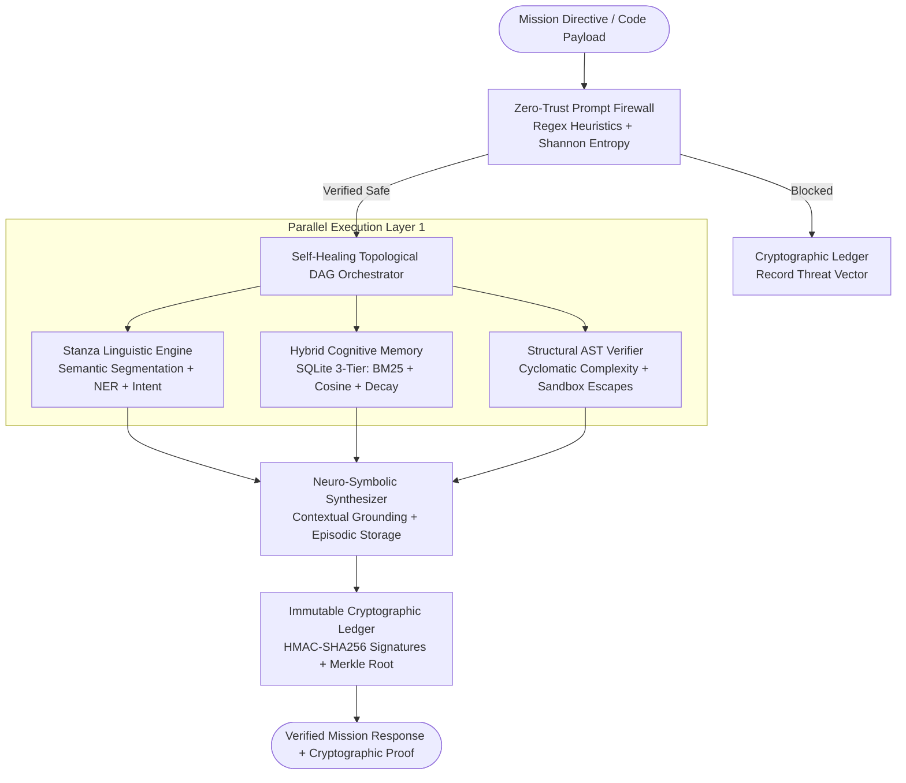

# Stanza Agent v3.0 — Sovereign Omni-Linguistic & Structural Autonomous Engine

[](https://github.com/allyxzs/stanza-agent/actions)
[](https://www.python.org/)
[](https://github.com/allyxzs/stanza-agent)
[](https://github.com/allyxzs/stanza-agent)
[](LICENSE)

**Stanza Agent v3.0** is an enterprise-grade autonomous multi-agent reasoning architecture engineered for deep linguistic segmentation ("Stanzas"), Python AST structural verification, hybrid cognitive memory retrieval, self-healing topological DAG orchestration, and immutable cryptographic auditability.

---

## Architectural Blueprint



---

## Core Subsystems (v3.0 Upgrade)

| Subsystem | Module | Key Capabilities |
| :--- | :--- | :--- |
| **Zero-Trust Shield** | `src/stanza/security/shield.py` | Multi-vector regex heuristics (System Override, Role Hijack, Command/SQL Injection, Python Sandbox Escape) + Shannon Entropy obfuscation detector. |
| **Cryptographic Ledger** | `src/stanza/security/audit.py` | Immutable hash-chained audit trail with **HMAC-SHA256** signatures and dynamic **Merkle Tree Root** recalculation on every state transition. |
| **Stanza Linguistic Engine** | `src/stanza/nlp/engine.py` | Decomposes unstructured text into semantic *Stanzas*, computes syntactic density & lexical complexity, extracts entities (IPv4, CVE, Hashes, Paths), and inspects Python AST trees. |
| **Hybrid Cognitive Memory** | `src/stanza/memory/cognitive_store.py` | Persistent SQLite 3-Tier store (`EPISODIC`, `SEMANTIC`, `PROCEDURAL`) combining **Okapi BM25**, **Cosine Vector Similarity**, and **Exponential Temporal Decay**. |
| **Self-Healing DAG Engine** | `src/stanza/core/dag.py` | Topological sort dependency resolution with cycle detection, concurrent layer execution (`asyncio.gather`), retry backoff, and autonomous fallback healing daemons. |
| **Sovereign API & CLI** | `src/stanza/api/` & `src/stanza/cli/` | High-performance **FastAPI** asynchronous REST server and **Rich/Typer** terminal interface. |

---

## Quickstart & Installation

```bash
# Install in editable mode with development dependencies
pip install -e ".[dev]"

# Verify subsystem matrix via CLI
stanza info

# Execute an autonomous mission from the terminal
stanza run "Audit CVE-2026-4410 on 10.0.0.15 and verify the hashing routine." --code "import hashlib
def h(x): return hashlib.sha256(x).hexdigest()"

# Verify cryptographic ledger integrity
stanza audit

# Run the complete verification test suite
pytest -v
```

---

## REST API Endpoints

Start the server via `uvicorn stanza.api.server:app --host 0.0.0.0 --port 8000`:

- `GET /health` — Subsystem status, memory metrics, and real-time Merkle Ledger integrity check.
- `POST /v1/mission` — Execute a complete Zero-Trust + DAG + AST mission pipeline.
- `POST /v1/memory` — Inject new Episodic, Semantic, or Procedural knowledge traces.
- `GET /v1/audit/verify` — Cryptographically validate the entire hash chain and HMAC signatures.

---

## License

Engineered by **allyxzs**. Released under the [MIT License](LICENSE).
