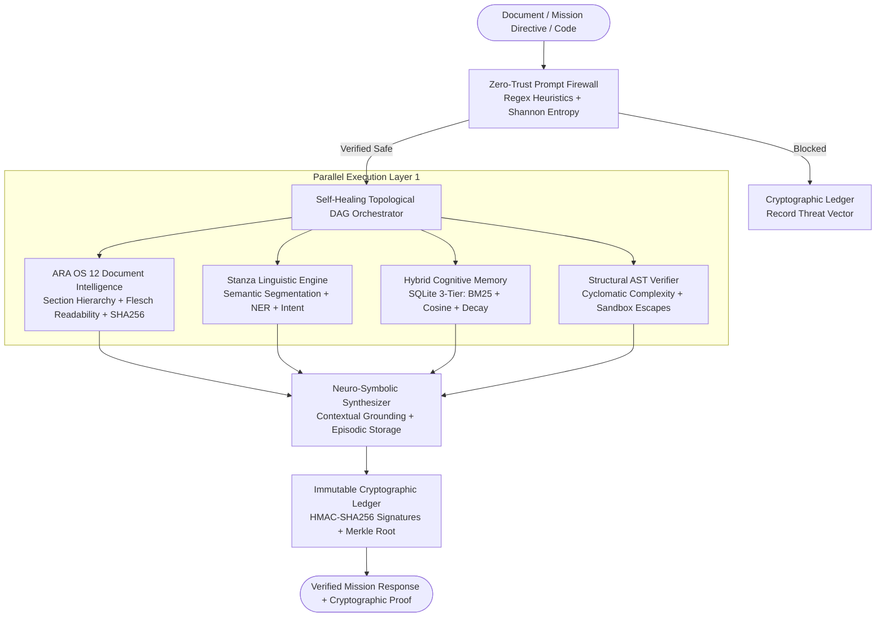

# Stanza Agent v3.2 — Sovereign Intelligent Document & Structural Engine for ARA OS 12

[](https://github.com/allyxzs/stanza-agent/actions)
[](https://www.python.org/)
[](https://github.com/allyxzs/stanza-agent)
[](https://github.com/allyxzs/stanza-agent)
[](LICENSE)

**Stanza Agent v3.2** is the Intelligent Document, Linguistic, and Structural Autonomous Agent engineered for **ARA OS 12**. It unifies deep hierarchical document intelligence, semantic "Stanza" segmentation, Python AST static verification, 3-tier hybrid cognitive memory, self-healing topological DAG orchestration, and immutable HMAC-SHA256 + Merkle Tree cryptographic provenance.

---

## Architectural Blueprint (v3.2 Sovereign Upgrade)



---

## Core Subsystems & v3.2 Improvements

| Subsystem | Module | Key Capabilities |
| :--- | :--- | :--- |
| **ARA OS 12 Document Engine** | `src/stanza/document/ara_engine.py` | Hierarchical Markdown/Document section parser, Flesch-Kincaid readability scoring, key-term TF extraction, and SHA-256 section fingerprinting. |
| **Zero-Trust Shield** | `src/stanza/security/shield.py` | Multi-vector regex heuristics (System Override, Role Hijack, Command/SQL Injection, Python Sandbox Escape) + Shannon Entropy obfuscation detector. |
| **Cryptographic Ledger** | `src/stanza/security/audit.py` | Immutable hash-chained audit trail with **HMAC-SHA256** signatures and dynamic **Merkle Tree Root** recalculation on every state transition. |
| **Stanza Linguistic Engine** | `src/stanza/nlp/engine.py` | Decomposes unstructured text into semantic *Stanzas*, computes syntactic density & lexical complexity, extracts entities (IPv4, CVE, Hashes, Paths), and inspects Python AST trees. |
| **Hybrid Cognitive Memory** | `src/stanza/memory/cognitive_store.py` | Persistent SQLite 3-Tier store (`EPISODIC`, `SEMANTIC`, `PROCEDURAL`) combining **Okapi BM25**, **Cosine Vector Similarity**, and **Exponential Temporal Decay**. |
| **Self-Healing DAG Engine** | `src/stanza/core/dag.py` | Topological sort dependency resolution with cycle detection, concurrent layer execution (`asyncio.gather`), retry backoff, and autonomous fallback healing daemons. |

---

## Quickstart & Verification

```bash
# Install in editable mode with development dependencies
pip install -e ".[dev]"

# Verify subsystem matrix via CLI
stanza info

# Execute an autonomous document & code mission
stanza run "# Kernel Audit
Verify CVE-2026-4410 on 10.0.0.15." --code "import hashlib
def h(x): return hashlib.sha256(x).hexdigest()"

# Run Ruff linter & Pytest suite
ruff check src/ tests/
pytest -v
```

---

## License

Engineered by **allyxzs**. Released under the [MIT License](LICENSE).
